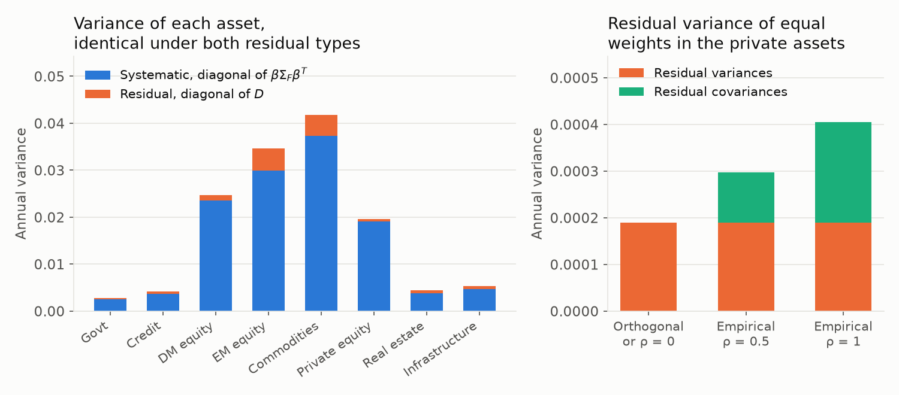

---
myst:
  html_meta:
    description: The TradableFactors owner and the supplied-input handoff to OptimalPortfolios for Factor covariance with HCGL.
---

# Factor covariance with HCGL

*Author: [Artur Sepp](https://github.com/ArturSepp)*

Implemented upstream in [TradableFactors](supplied_risk_inputs.md#tradablefactors-availability),
consumed by [OptimalPortfolios](https://github.com/ArturSepp/OptimalPortfolios).
Software citation: [CITATION.cff](https://github.com/ArturSepp/OptimalPortfolios/blob/main/CITATION.cff).
Upstream citation: `CITATION.cff` in an authorised TradableFactors checkout.

Factor covariance construction, loadings, annualisation, residual policy and completed factor models belong to TradableFactors. OP consumes the selected dated covariance and supplied expected returns.

## Canonical method and runnable workflow

The full methodology and implementation guide has moved to TradableFactors with
its original authorship and source history. TF is private and unreleased; see the
[availability prerequisite](supplied_risk_inputs.md#tradablefactors-availability).
In an authorised TF checkout, `docs/factor_covariance_hcgl.md`
contains the estimator, units, date cutoffs, diagnostics and runnable examples.
This local page records the owner and OP handoff, not the full private methodology.
The old OP estimator and inference exports are removed in OP 8; there are no forwarding APIs.

OP is complete once it produces the allocation and its solver outcome. See the
[completed optimisation output](completed_output.md), [supplied risk inputs](supplied_risk_inputs.md)
and [solver outcomes](solver_numerics_and_outcomes.md). The retained
[EWMA estimator](covariance_estimators.md) is an explicit OP preparation utility.

## Earlier links

The former section anchors are retained below so links from existing OP guides
arrive at this ownership handoff. The authorised TF guide contains the corresponding method.

## Historical exhibit

This synthetic exhibit remains with its existing reviewed publication receipt and unchanged
OP producer. The current method and numerical example are maintained in TradableFactors.
The image compares systematic and residual variance, including the effect of retaining
residual correlation in the synthetic private-asset sleeve.

